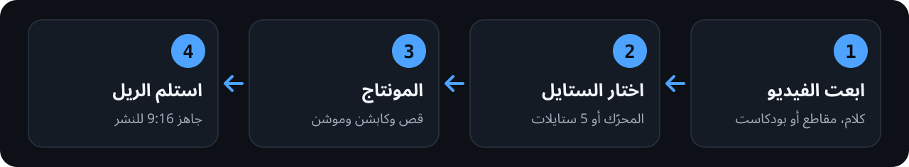
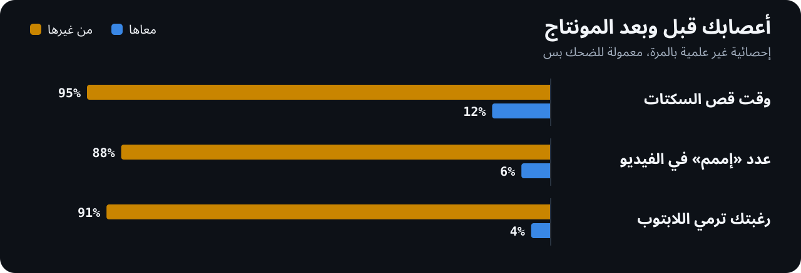

<p align="center"><a href="README.md">English</a> · <b>العربية</b></p>

<p align="center"></p>

> **مونتاج من غير ما تشد في شعرك.** كوليكشن بتتحدّث دايماً فيها أحسن أدوات ومهارات المونتاج والموشن بالذكاء الاصطناعي في سكيل واحدة. بتشيل السكتات، وتحوّل فيديو الكلام لريل 9:16، وتركّب كابشن متزامن بأي لغة، وتضيف موشن جرافيكس وB-roll. جواها: محرّك مونتاج كامل، و5 ستايلات موشن، ومؤثرات صوتية حقيقية على الفريم بالظبط، ودبلجة للغة أو لهجة تانية بصوت المتحدث نفسه. وكل جزء مدموج محفوظ حق صاحبه. وبتمشي على فولدر Reference وملف Brand لو موجودين. *(اسمها القديم Marwan Video Edit.)*

## بتشتغل إزاي؟

<p align="center"></p>

## قولها كده وسيبها تشتغل

- «منتج الفيديو ده وشيل السكتات»
- «حوّل الفيديو لريل بكابشن بلغتي»
- «اعمل مونتاج لبودكاست بكاميرتين»
- «حط مؤثرات صوتية حقيقية على الإعلان ده»
- «خلي الفيديو يتكلم إسباني (أو سعودي) بصوتي»
- «اعمل ريل قبل وبعد ابتسامة من الصور دي»

## جواها إيه؟ (واختار انت تنزّل إيه)

الكوليكشن فيها سكيلز وأدوات تانية بتنزل معاها. لما تطلب من Claude Code يسطبها، هيعرض عليك كل جزء ويشرحلك بيعمل إيه وأهميته، وانت تختار تنزّل **كله**، أو **المجموعة المقترحة**، أو **الأجزاء اللي تختارها بس**. القايمة الكاملة بالحجم والمتطلبات والرخص في [`COMPONENTS.md`](skills/best-video-edit-motion-collection/COMPONENTS.md).

| المجموعة | الأجزاء |
|---|---|
| المحرّك | مونتاج كامل بأي لغة: سكتات، ريلز، كابشن، مونتاج، بودكاست، استوديو باللمس |
| ستايلات الموشن | HyperFrames · onetake (غير تجاري) · Collage B-roll (مفتاح مدفوع) · كرتون Clawd · Lemo-Opuscar (43 ستايل) |
| الصوت | كيت أصوات CC0 · بحث Openverse · real-sfx (Clipwing) · earshot (Leon Lin) |
| الصوت البشري | دبلجة للغة أو لهجة تانية بصوت المتحدث (ElevenLabs، مدفوع) |

أي أداة أو طريقة جديدة كويسة بتتضاف كجزء جديد، وصاحبها مذكور في `NOTICE.md`.

## النتايج (بهزر، بس بجد مفيدة)

<p align="center"></p>

## ركّبها في دقيقة

| بتستخدم إيه؟ | الطريقة |
|---|---|
| حساب Claude أو ChatGPT | نزّل [`best-video-edit-motion-collection.zip`](https://github.com/Marsadgrouplabs/best-video-edit-motion-collection/releases/latest/download/best-video-edit-motion-collection.zip) وارفعه من قسم Skills |
| Claude Code | `claude plugin marketplace add Marsadgrouplabs/best-video-edit-motion-collection` |
| Claude Code أو Codex بسكربت | حمّل الـ repo وشغّل `install.ps1` أو `install.sh` |

<details>
<summary><b>الخطوات بالتفصيل</b></summary>

### حساب Claude أو ChatGPT

1. نزّل [`best-video-edit-motion-collection.zip`](https://github.com/Marsadgrouplabs/best-video-edit-motion-collection/releases/latest/download/best-video-edit-motion-collection.zip) وماتفكّهوش.
2. **Claude:** افتح قسم Skills في حسابك واختار رفع ملف.
3. **ChatGPT:** افتح Skills، ثم Create، ثم Upload from your computer. الميزة متاحة حسب خطة الحساب.

### Claude Code كـ Plugin

```bash
claude plugin marketplace add Marsadgrouplabs/best-video-edit-motion-collection
claude plugin install best-video-edit-motion-collection@marsad-best-video-edit-motion-collection
```

### ويندوز

```powershell
git clone https://github.com/Marsadgrouplabs/best-video-edit-motion-collection.git
cd best-video-edit-motion-collection
powershell -ExecutionPolicy Bypass -File .\install.ps1                     # asks which parts
powershell -ExecutionPolicy Bypass -File .\install.ps1 -Components all     # or: recommended, or IDs like engine-a,sfx-kit
```

### ماك أو لينكس

```bash
git clone https://github.com/Marsadgrouplabs/best-video-edit-motion-collection.git
cd best-video-edit-motion-collection
bash install.sh                 # asks which parts
bash install.sh claude all      # or: recommended, or IDs like engine-a,sfx-kit
```

السكربت بيركّبها لـ Claude Code في `~/.claude/skills` ولـ Codex في `~/.agents/skills`، ولو فيه نسخة قديمة بيحتفظ بيها. ولو عايز تضيف أجزاء بعدين، شغّله تاني بأسماء الأجزاء.

</details>

## مطمنك: مين الناشر وبياناتك فين؟

جمعتها وطورتها **[Marsad Labs](https://labs.marsadgroup.co)**، وفيها أجزاء مفتوحة المصدر مذكور أصحابها في `NOTICE.md`. Marsad Labs هي ذراع المنتجات في Marsad Group، شركة تسويق مسجلة في بريطانيا، وبتبني أدوات عملية للمسوقين والمطورين. [اعرف أكتر عننا](https://labs.marsadgroup.co/about-us/) · [سياسة الخصوصية](https://labs.marsadgroup.co/privacy-policy/)

| السؤال | الإجابة |
|---|---|
| **بتقرا إيه؟** | الفيديوهات والملفات اللي بتديهالها بس. |
| **الفيديو بيروح فين؟** | المونتاج بيتم على جهازك. لو طلبت توليد مشاهد أو صور، الطلب بيروح للخدمة اللي اخترتها زي fal.ai أو Google. |
| **محتاجة مفاتيح؟** | لأ للمونتاج العادي. مفاتيح التوليد اختيارية وبتفضل عندك. |
| **المؤثرات الصوتية** | البحث في Openverse بيبعت كلمات البحث بس. كل صوت برخصة صاحبه ومكتوبة في `CREDITS.md`. |
| **الدبلجة** | استنساخ الصوت وتحريك الشفايف بيتم على حساب ElevenLabs بتاعك. استنسخ صوتك انت بس أو صوت معاك إذن صاحبه. |
| **تنبيه صريح** | استوديو التعديل بيفتح رابط على شبكتك المحلية طول ما هو شغال، فاقفله لما تخلص. وصفحة سماع الأصوات بتفضل على جهازك بس. |

النسخة دي اتفحصت بأداة SkillSpector، واتراجعت تنبيهاتها الحرجة والعالية يدوياً، واتشال منها أي بيانات عملاء أو مفاتيح. النتيجة الكاملة وطريقة التأكد من الملف والإبلاغ عن مشكلة في [`SECURITY.ar.md`](SECURITY.ar.md).

## محتاج إيه؟

- **التنفيذ الكامل:** Claude Code أو Codex على الجهاز، مع Python وNode.js وffmpeg وWhisper.
- **اختياري:** مفاتيح خدمات توليد المشاهد والصور، لو هتستخدمها.

## قبل ما تبدأ

- **نسخة الحساب خفيفة:** الحساب بيقبل 200 ملف كحد أقصى، فملف `best-video-edit-motion-collection.zip` فيه التعليمات والمراجع بس. بيخطط ويكتب السيناريو والكابشن، لكن القص والتصدير محتاجين النسخة الكاملة على الجهاز.
- **ستايل `onetake`:** رخصته غير تجارية، فماتستخدموش في شغل عملاء أو شغل مدفوع. متعلّم عليه في `COMPONENTS.md` ومش في المجموعة المقترحة.

## الحقوق

الـ skill فيها أجزاء من مشاريع تانية، كل جزء محتفظ برخصته. التفاصيل في `NOTICE.md`.

---

<p align="center">معمولة بحب وشاي كتير في <a href="https://labs.marsadgroup.co"><b>Marsad Labs</b></a></p>
