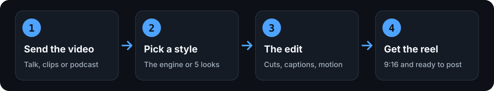
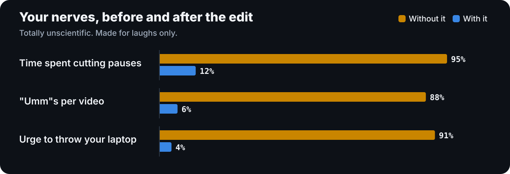

<p align="center"><b>English</b> · <a href="README.ar.md">العربية</a></p>

<p align="center"></p>

> **Edit videos without losing your hair.** An always-updated collection of the best AI video editing and motion tools and skills, in one skill. It removes silences, turns talking videos into 9:16 reels, adds word-synced captions in any language, and layers in motion graphics and B-roll. Inside: a full editing engine, 5 motion styles, real sound effects placed on the exact frame, and dubbing into another language or dialect in the speaker's own voice. Every bundled part keeps its author's credit. It follows your Reference folder and Brand file when they exist. *(Formerly Marwan Video Edit.)*

## How it works

<p align="center"></p>

## Just say it

- "Edit this video and remove the silences"
- "Turn this video into a reel with captions in my language"
- "Edit a two-camera podcast"
- "Add real sound effects to this promo"
- "Make this video speak Spanish (or Saudi Arabic) in my own voice"
- "Make a before/after smile reel from these photos"

## What is inside (pick what you install)

The collection bundles other skills and tools. When you ask Claude Code to install it, Claude lists each part, explains what it does and why it matters, and lets you install **everything**, the **recommended set**, or **only the parts you pick**. The full list with sizes, needs and licences is in [`COMPONENTS.md`](skills/best-video-edit-motion-collection/COMPONENTS.md).

| Group | Parts |
|---|---|
| Engine | Full editor for any language: silences, reels, captions, montage, podcast, touch studio |
| Motion styles | HyperFrames · onetake (non-commercial) · Collage B-roll (paid key) · Clawd cartoon · Lemo-Opuscar (43 looks) |
| Sound | CC0 sound kit · Openverse search · real-sfx (Clipwing) · earshot (Leon Lin) |
| Voice | Language and dialect dubbing in the speaker's voice (ElevenLabs, paid) |

New tools and workflows are added as new parts over time, each credited to its author in `NOTICE.md`.

## The results (joking, but also not really)

<p align="center"></p>

## Install in a minute

| You use | How to install |
|---|---|
| A Claude or ChatGPT account | Download [`best-video-edit-motion-collection.zip`](https://github.com/Marsadgrouplabs/best-video-edit-motion-collection/releases/latest/download/best-video-edit-motion-collection.zip) and upload it under Skills |
| Claude Code | `claude plugin marketplace add Marsadgrouplabs/best-video-edit-motion-collection` |
| Claude Code or Codex with a script | Clone the repo and run `install.ps1` or `install.sh` |

<details>
<summary><b>Step-by-step instructions</b></summary>

### Claude or ChatGPT account

1. Download [`best-video-edit-motion-collection.zip`](https://github.com/Marsadgrouplabs/best-video-edit-motion-collection/releases/latest/download/best-video-edit-motion-collection.zip) and keep it zipped.
2. **Claude:** open Skills in your account and choose to upload a file.
3. **ChatGPT:** open Skills, then Create, then Upload from your computer. Availability depends on your plan.

### Claude Code plugin

```bash
claude plugin marketplace add Marsadgrouplabs/best-video-edit-motion-collection
claude plugin install best-video-edit-motion-collection@marsad-best-video-edit-motion-collection
```

### Windows

```powershell
git clone https://github.com/Marsadgrouplabs/best-video-edit-motion-collection.git
cd best-video-edit-motion-collection
powershell -ExecutionPolicy Bypass -File .\install.ps1                     # asks which parts
powershell -ExecutionPolicy Bypass -File .\install.ps1 -Components all     # or: recommended, or IDs like engine-a,sfx-kit
```

### macOS or Linux

```bash
git clone https://github.com/Marsadgrouplabs/best-video-edit-motion-collection.git
cd best-video-edit-motion-collection
bash install.sh                 # asks which parts
bash install.sh claude all      # or: recommended, or IDs like engine-a,sfx-kit
```

The script installs to `~/.claude/skills` for Claude Code and `~/.agents/skills` for Codex, and keeps a backup of any older copy. Run it again with other part IDs to add parts later.

</details>

## Who publishes this, and where does your data go?

Assembled and developed by **[Marsad Labs](https://labs.marsadgroup.co)**. It includes open-source parts whose authors are credited in `NOTICE.md`. Marsad Labs is the product arm of Marsad Group, a UK-registered marketing agency, and builds practical tools for marketers and developers. [About us](https://labs.marsadgroup.co/about-us/) · [Privacy policy](https://labs.marsadgroup.co/privacy-policy/)

| Question | Answer |
|---|---|
| **What does it read?** | Only the videos and files you give it. |
| **Where does the video go?** | Editing runs on your computer. If you ask for generated scenes or images, that request goes to the service you chose, such as fal.ai or Google. |
| **Does it need API keys?** | Not for regular editing. Generation keys are optional and stay with you. |
| **Sound effects** | Openverse searches send only the search words. Sounds keep their creator's licence, listed in `CREDITS.md`. |
| **Dubbing** | Voice cloning and lip sync run on your own ElevenLabs account. Clone only your own voice or one you have permission for. |
| **Heads-up** | The editing studio opens a link on your local network while it runs, so close it when you finish. The sound listening page stays on your computer only. |

This version was scanned with SkillSpector, its critical and high alerts were reviewed by hand, and client data and keys were removed. The full result, how to verify the file and how to report a problem are in [`SECURITY.md`](SECURITY.md).

## What you need

- **Full editing:** Claude Code or Codex on your computer, with Python, Node.js, ffmpeg and Whisper.
- **Optional:** API keys for scene and image generation services, if you plan to use them.

## Before you start

- **The account version is a light build:** accounts accept 200 files at most, so `best-video-edit-motion-collection.zip` holds the instructions and references only. It plans and writes scripts and captions, but cutting and exporting need the full version on your computer.
- **`onetake` style:** it has a non-commercial license, so don't use it for client or paid work. It is marked in `COMPONENTS.md` and is not in the recommended set.

## Rights

This skill includes parts from other projects, and each part keeps its own license. Details are in `NOTICE.md`.

---

<p align="center">Made with love and far too much tea at <a href="https://labs.marsadgroup.co"><b>Marsad Labs</b></a></p>
